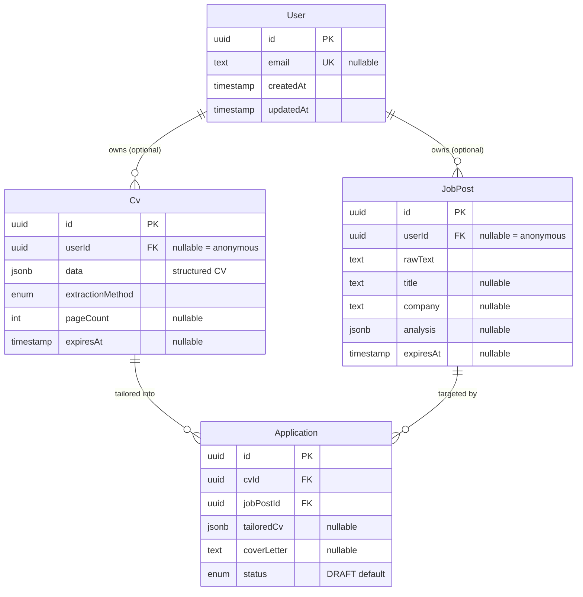

# Database

Postgres 18 in Docker, accessed through Prisma 7.10.1. Schema: `prisma/schema.prisma`. Migrations: `prisma/migrations/`. Setup, Docker commands and `DATABASE_URL`: see `architecture.md`.

First migration: `20261113132759_create_core_models` (Task 3).

## Diagram



Every model also has `createdAt` and `updatedAt`. All foreign keys are `ON DELETE CASCADE`.

## Models

| Model         | Purpose                                                                  | Notable fields                                                                                  |
| ------------- | ------------------------------------------------------------------------ | ----------------------------------------------------------------------------------------------- |
| `User`        | Minimal identity. Accounts (Auth.js) come in Phase 3.                    | `email` optional and unique                                                                     |
| `Cv`          | The user's base CV as structured data. No PDF and no raw text are stored. | `data` Json, `extractionMethod` (`PDF_TEXT`, `PDF_LLM`, `MANUAL`), `pageCount`, `expiresAt`     |
| `JobPost`     | A pasted job posting and its analysis.                                   | `rawText`, `title`/`company` (NULL until extracted), `analysis` Json (NULL until analysed)      |
| `Application` | One Cv tailored to one JobPost.                                          | `tailoredCv` Json, `coverLetter`, `status` (`DRAFT`, `REVIEWED`, `DOWNLOADED`)                  |

### Modelling decisions

- **uuid ids** (`String @id @default(uuid()) @db.Uuid`): not guessable, native Postgres type. The uuid is generated by Prisma Client, not by Postgres, so there is no DB default: raw SQL inserts must provide `id` (and `updatedAt`, see below).
- **Json columns are `jsonb`.** The shape of a CV changes as prompts evolve, so it is not frozen into columns. Validation is done with zod in the app. Trade-off: the database does not enforce the shape and queries inside the JSON are awkward.
- **Enums are native Postgres enums.** Typos are impossible. Adding a value needs a migration; removing one is awkward.
- **`updatedAt` is set by Prisma** (`@updatedAt`), not by a database trigger. A manual `UPDATE` in SQL will not change it, and the column has no default (raw inserts must provide it).
- **Foreign keys are indexed explicitly** (`@@index`) because Postgres does not index them automatically. This keeps "all CVs of a user" and cascade deletes fast.
- **`Application` has no `userId`.** Its owner is the owner of its `Cv`: one source of truth. Trade-off: "my applications" needs a JOIN through `Cv`, and the rule "the Cv and the JobPost belong to the same user" is checked in the app, because the database cannot enforce it.
- **No unique `(cvId, jobPostId)`.** The same CV can be tailored several times to the same job (several versions). A unique constraint can be added later.
- **Optional relations need `onDelete: Cascade` written explicitly.** Prisma's default for an optional relation is `SetNull`, which would leave orphaned rows.

## Relation to User and Phase 3

`userId` is optional on `Cv` and `JobPost`. NULL means an anonymous record. In Phase 3, signing in can "claim" anonymous records with one statement: set `userId` and clear `expiresAt`. Auth.js needs its own tables (`Account`, `Session`, `VerificationToken`) and extra `User` columns (`name`, `image`, `emailVerified`). Those are new tables or nullable columns, so no existing table has to be rewritten. (To be checked against the Auth.js docs in Phase 3.)

## Privacy decisions

- **Data minimisation.** The original PDF and the raw CV text are never stored; only the structured JSON the app needs. The job posting text (`rawText`) is stored so it can be analysed again; it can be dropped later if it is not needed.
- **Cascading deletes.** Deleting a `User` deletes their `Cv` and `JobPost` rows, and those delete their `Application` rows. Deleting a `Cv` or a `JobPost` deletes the Applications that depend on it. This makes "delete my data" one statement and leaves no orphans. Verified with SQL inside a rolled-back transaction: deleting a user removed their Cv, JobPost and Application; an anonymous Cv was untouched.
- **Expiry for anonymous records.** `expiresAt` (nullable, indexed) on `Cv` and `JobPost`. `Application` has no expiry of its own: it disappears by cascade when its Cv or JobPost expires. **Only the column exists today. A cleanup job that deletes expired rows is not built yet** (a later task). The rule "if `userId` is NULL then `expiresAt` must be set" is not a database constraint (Prisma cannot declare a `CHECK`); the app must enforce it.
- **No CV or job posting content in logs.** See `CLAUDE.md`. The database is the only place this personal data lives.

### Anonymous records are protected only by their UUID

A record with `userId` NULL has no owner. Whoever knows its UUID can read it through the API. A random uuid (v4, 122 random bits) cannot be guessed or enumerated, so the id works as a secret link.

Why this is acceptable for the prototype:

- There are no API routes yet and the database is only reachable from this PC (`127.0.0.1`).
- Records are meant to be short-lived (`expiresAt`).
- Simplicity: no session or cookie machinery is needed to try the core flow.

Known limits: anyone who gets the id (browser history, a shared link, a log line, a screenshot) gets the data, and it cannot be revoked. The app also has no way to list "my anonymous records" unless the browser remembers the ids.

Alternative, to be decided in Phase 2 when the API routes exist: add a nullable column such as `anonSessionId` to `Cv` and `JobPost`. The server sets a random value in an httpOnly cookie, stores it (ideally hashed) in that column, and the API only returns a record if the cookie matches. It would be an additive migration (a nullable column plus an index). **Not added now.**

## Not done yet

- A job that deletes expired anonymous records.
- Seed data, API routes and UI.
- Shared Prisma client in `src/lib/` (`scripts/db-check.ts` builds its own for now).

## Working with the schema

```bash
npm run db:migrate -- --name <short_name>   # create + apply a migration after editing schema.prisma
npm run db:generate                         # regenerate generated/prisma (Prisma 7 does NOT do it in migrate dev)
npm run db:studio                           # browse data; prints its URL (it used http://localhost:51212)
npx prisma migrate status                   # are all migrations applied?
npx prisma migrate reset                    # DROP everything and re-apply migrations (asks to confirm)
docker exec -it cv-tailor-db psql -U cvtailor -d cvtailor    # then \dt, \d "Cv", SELECT ...
```

Table names keep Prisma's defaults (`"JobPost"`), so in psql they need double quotes. Commit `prisma/migrations/` (including `migration_lock.toml`); never edit an applied migration, create a new one instead.
